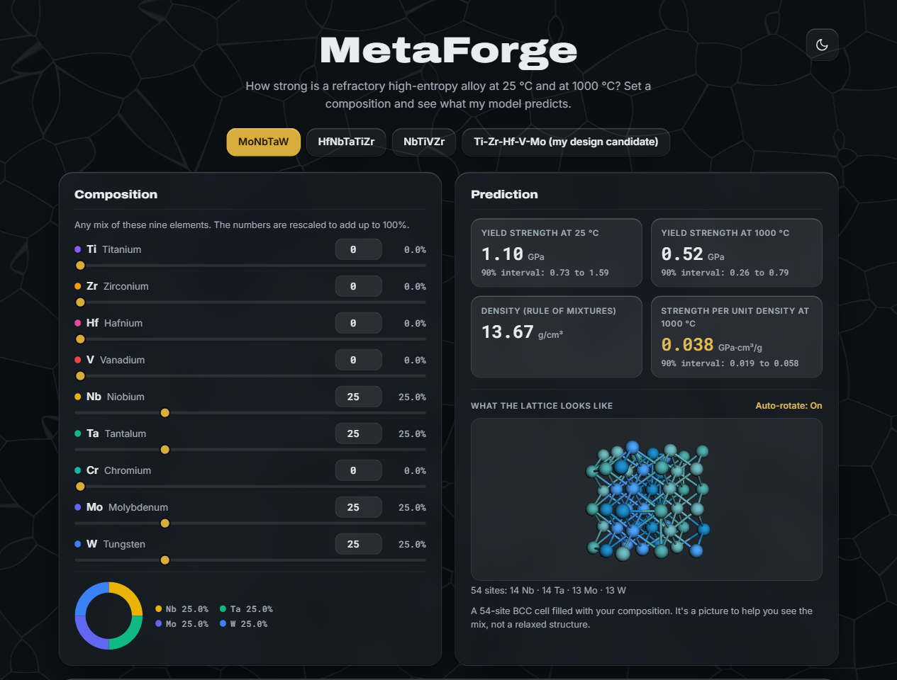

# MetaForge

How strong is a refractory high-entropy alloy at room temperature and at 1000 °C, and can a model tell you before anyone melts it? MetaForge is my attempt at that question for alloys of Ti, Zr, Hf, V, Nb, Ta, Cr, Mo and W.

**Try it:** [metaforge-web.onrender.com](https://metaforge-web.onrender.com). Set a composition and it predicts the yield strength at 25 °C and 1000 °C, with a 90% interval. The free server sleeps when idle, so the first load can take about a minute.

[](https://metaforge-web.onrender.com)

> Reviewing this work? The manuscript and the research proposal for the next phase are not public yet. I am happy to send both: ahedorsolomon@gmail.com.

## What I found

**1. Theory plus a learned correction beats either one alone.** I collected 277 measured yield strengths of 72 single-phase BCC alloys, tested from −269 to 1600 °C, from the open MPEA dataset. Maresca and Curtin's edge-dislocation theory, with no fitting, explains 45% of the variance, but only 10% on alloys first reported in 2019. Training a model on the theory's errors lifts that to R² = 0.67 on unseen alloys, 0.64 on unseen alloy systems and 0.65 on the 2019 alloys. Its 90% conformal intervals held 84 to 88% of the measurements.

**2. Universal ML potentials get the lattice right and the stiffness wrong.** CHGNet, MACE and SevenNet reproduce the lattice parameters of the nine elements within 1.7%. Their shear elastic constants are too soft, by a median factor of 2.6 and up to 50, and six of the 54 values are negative, which means an unstable BCC lattice. Fed into the strength theory, they push R² below zero, so they cannot replace measured inputs yet.

**3. The design search needs guard rails.** Left alone, a multi-objective search (NSGA-II) picks Zr-W alloys that would likely form Laves phases. With a phase rule learned from which element pairs appear in reported single-phase alloys, it lands on Ti-Zr-Hf-V-Mo alloys predicted to match the specific strength of the strongest measured alloys at 1000 °C at 24 to 29% lower density. The catch: Ti-Zr-V alloys lose most of their strength between 600 and 1000 °C (NbTiVZr drops from 834 to 58 MPa), so one of these alloys has to be tested at temperature before I believe it.

## Run it yourself

The strength models and the design search run in one Python environment (pymatgen, matminer, scikit-learn, pymoo). The ML potentials have heavier dependencies, so I run those benchmarks in a second environment with CHGNet, MACE and SevenNet. Each script says which one it needs.

```bash
python scripts/build_rhea_dataset.py              # measured strengths -> data/processed/rhea_strength.csv
python scripts/strength_models.py                 # theory, ML and hybrid models -> results/strength_models.csv
python scripts/mlip_elements.py chgnet mace sevennet    # potentials on the nine elements
python scripts/mlip_alloys.py mace                # potentials on 15 alloy supercells
python scripts/mlip_strength_inputs.py            # potential inputs fed into the theory
python scripts/phase_domain.py                    # element-pair phase rule
python scripts/design_nsga2.py                    # design search -> results/design_pareto.csv
python scripts/make_figures.py                    # figures from the result files
python scripts/export_web_model.py                # copies the hybrid model into the web app
python -m pytest tests                            # library tests
```

To run the web app locally:

```bash
cd MetaForge-Web
python app.py        # then open http://127.0.0.1:5000
```

## What is in the repo

```text
data/processed/     the strength dataset and its data card
metaforge/          the strength theory, the phase rule and the potential helpers
scripts/            everything that produces a number in results/
results/            CSV outputs and logs
MetaForge-Web/      the web app (Flask) and its tests
tests/              library tests
run_master.py,      an earlier exploration across several alloy families
notebooks/
```

## What comes next

- Make one Ti-Zr-Hf-V-Mo candidate and test it in compression between 600 and 1000 °C.
- Fine-tune a potential on a few DFT elastic constants and check whether the softening goes away.
- Extend the model to corrosion-resistant and lightweight high-entropy alloys.

## Data and credits

- Yield strengths: C.K.H. Borg et al., *Scientific Data* 7 (2020) 430, the open MPEA dataset.
- Strength theory: F. Maresca and W.A. Curtin, *Acta Materialia* 182 (2020) 235–249, with element data from C. Lee et al., *Nature Communications* 12 (2021) 5474.
- Potentials: CHGNet (B. Deng et al., *Nature Machine Intelligence* 5 (2023) 1031), MACE-MP-0 (I. Batatia et al., arXiv:2401.00096) and SevenNet-0 (Y. Park et al., *J. Chem. Theory Comput.* 20 (2024) 4857). On their softening, see B. Deng et al., *npj Computational Materials* 11 (2025) 9.
- Intervals: Y. Romano, E. Patterson and E.J. Candès, conformalized quantile regression, NeurIPS 2019.

## License and contact

MIT License. Solomon Ahedor, Department of Materials and Metallurgical Engineering, KNUST, Ghana. ahedorsolomon@gmail.com
